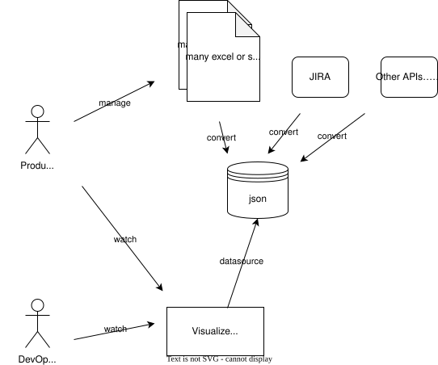

# product-measurement

[](https://github.com/go-zen-chu/product-measurement/actions/workflows/ci.yml)
[](https://github.com/go-zen-chu/product-measurement/actions/workflows/push-image.yml)

Measure, store, visualize about your product & prject.



## Design

1. Grafana has infinity-datasource which can read data from json api
2. ./server provides simple json server that can read local json data and respond as json api

## Run

```console
docker compose up
```
